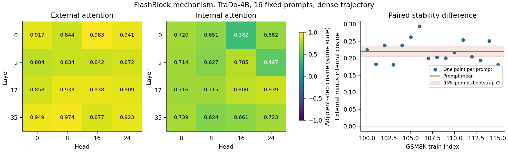
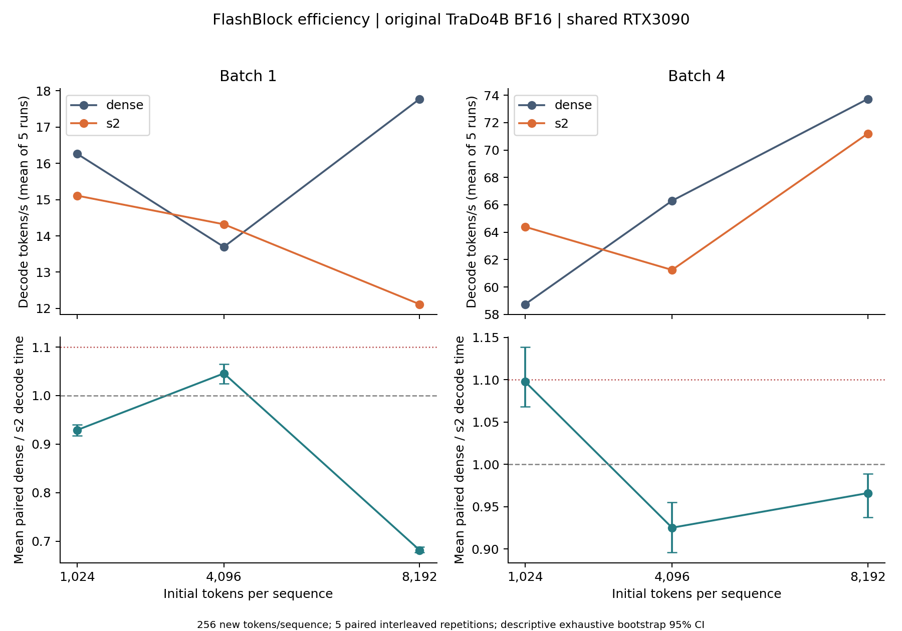
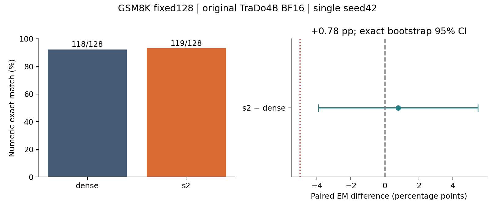

<div align="center">

# FlashBlock · 最小复现

**Attention Caching for Efficient Long-Context Block Diffusion**

在一张共享 RTX 3090 上，验证注意力缓存的机制、速度与答案质量。

`TraDo4B` · `BF16` · `RTX 3090` · `GSM8K` · `实验已完成`

[结果速览](#结果速览) · [实验图表](#实验图表) · [快速复算](#快速复算) · [完整报告](REPORT.zh.md) · [复现协议](PROTOCOL.md)

</div>

---

本项目基于 FlashBlock 上游实现，比较原始 **TraDo-4B-Instruct** 在完整注意力基线（`dense`）与缓存复用（`s2 / τ=2`）下的表现。我们完成了数值验证、机制测量、60 次效率计时，以及固定 128 道 GSM8K 测试题的双条件评测，并独立核验了统计与原始输出。

> **主要结论：** 块外注意力输出表现出更高的相邻步骤稳定性；但主要效率设置只有 **0.9661×**，没有达到 **1.10×** 的预设目标。质量差异的置信区间跨过零，不能据此宣称提升或等价。
>
> 本实验采用未蒸馏 4B 模型和共享消费级 GPU，研究范围不覆盖论文的 8B 蒸馏模型、32k+ 上下文或 A100 主表。

## 结果速览

| 检查内容 | 核心结果 | 如何理解 |
|:---|:---|:---|
| **机制** | 块外 / 块内相邻余弦相似度 **0.8998 / 0.6797** | 支持块外相对稳定；复用仍有近似误差 |
| **主要效率** | batch 4 × 每序列 8192 tokens：**0.9661×**；95% CI **[0.9377, 0.9888]** | 本设置未加速，未达到 1.10× 目标 |
| **答案质量** | dense **118/128** → s2 **119/128**；差值 **+0.78 个百分点** | 95% CI **[−3.91, +5.47]** 个百分点；没有明确的提升证据 |
| **证据核验** | **256** 份输出重新解码与评分；**128** 条提示和标准答案独立核对 | 全部匹配；无截断或空输出 |

完整运行按保守口径计费 **2.70 / 8.00 GPU 小时**，包含失败尝试和调度等待，不代表实测 GPU 忙碌时间。实验完成时，本项目 GPU 进程已退出。

## FlashBlock 缓存什么

块扩散模型会对当前 token 块反复去噪。每一步都需要计算当前查询对历史块和当前块的注意力，长历史上的重复计算因此成为可优化的部分。

FlashBlock 将注意力分成两部分：

| 部分 | 对应内容 | 本项目中的处理 |
|:---|:---|:---|
| **块外 `A_out`** | 当前查询对历史 token 的注意力输出 | 满足复用条件时，读取缓存的输出及其 LSE 归一化量 |
| **块内 `A_in`** | 当前查询对正在去噪的 token 块的注意力输出 | 使用当前状态重新计算 |
| **合并输出** | 两部分共同形成的注意力结果 | 根据 LSE 合并，保持两部分的归一化权重 |

历史 KV 仍完整保留。这里研究的是**避免重复计算**；`τ=2` 也不意味着每隔一步必然复用。在主要效率设置中，实际复用仅占去噪行的 **9.20%**。

## 实验图表

### ① 机制：相对稳定，但并非无损

固定 16 条训练集提示，采样 4 层 × 4 个注意力头，并按提示等权汇总。块外与块内相邻余弦相似度之差为 **0.2201**，提示级 bootstrap 95% CI 为 **[0.2051, 0.2364]**。



实际复用输出相对新鲜全注意力参考的平均逐 query / head 相对 L2 误差为 **0.2430**。这衡量中间表示的近似差异，不能当作答案错误率。

[机制审查](experiments/flashblock-20261023-mechanism/supervisor-review.md) · [误差图](experiments/flashblock-20261023-mechanism/figures/mechanism-errors.png) · [下载矢量图 PDF](experiments/flashblock-20261023-mechanism/figures/mechanism-stability.pdf)

### ② 效率：收益随设置变化，主要设置未加速

每个设置固定生成 **256 个新 tokens / 序列**，完成 **5 对交替顺序计时**。预热、编译和剖析不计入正式计时；解码包含调度、采样以及缓存写入和合并。



| 每序列初始 tokens | batch 1 | batch 4 |
|---:|---:|---:|
| 1024 | 0.9290× | 1.0975× |
| 4096 | 1.0458× | 0.9252× |
| 8192 | 0.6815× | **0.9661× — 主要设置** |

表中为平均配对加速比，**大于 1 表示复用更快**。主要设置的基线 / 复用的汇总吞吐分别为 **73.70 / 71.16 tokens/s**。

共享 GPU 的计时区间仅描述本次测量的波动；不同长度使用不同的冻结文本，曲线也不能单独证明上下文长度的因果影响。

[效率审查](experiments/flashblock-20261023-efficiency/supervisor-review.md) · [独立剖析图](experiments/flashblock-20261023-efficiency/figures/efficiency-profile.png) · [下载矢量图 PDF](experiments/flashblock-20261023-efficiency/figures/efficiency-context.pdf)

### ③ 质量：128 题配对评测，保留不确定性

测试题 ID 在生成前冻结。两条件采用相同模型、提示模板与采样配置，使用普通 EOS 和 4096 个新 tokens 上限；所有答案均正常以 EOS 结束。



| 指标 | dense | s2 / τ=2 |
|:---|---:|---:|
| 正确题数 | 118 / 128 | 119 / 128 |
| 数值精确匹配率 | 92.1875% | 92.96875% |
| 平均新 tokens | 223.95 | 227.49 |
| 截断 / 空输出 | 0 / 0 | 0 / 0 |

两条件均正确 **114** 题，仅 dense 正确 **4** 题，仅 s2 正确 **5** 题，均错误 **5** 题。

**评分细节影响这一个答案的差距：** 两边通过 `boxed` 提取得到的正确数都是 118；s2 另有一题通过预先规定的“最后数值”回退规则答对。评分器在测试前冻结，结果出来后没有修改规则。128 题、单种子的结果不能证明质量提升或等价。

[质量审查](experiments/flashblock-20261023-quality/supervisor-review.md) · [脱敏逐题指标](experiments/flashblock-20261023-quality/quality-per-item.json) · [下载矢量图 PDF](experiments/flashblock-20261023-quality/figures/quality-paired.pdf)

## 快速复算

**只重算已保存的统计与图表，无需 GPU、模型权重或原始 GSM8K 数据。** 以下命令在仓库根目录运行，将新结果写入 `/tmp/`，保留仓库内的历史产物。

### 准备分析环境

公开仓库可直接克隆：

```bash
git clone --branch exp/flashblock-20261023 \
  https://github.com/Flutter-Misdreavus/flashblock-reproduction.git
cd flashblock-reproduction

# 分析环境：与已执行的独立复算采用相同主要依赖版本
python3.10 -m venv .venv
source .venv/bin/activate
python -m pip install numpy==1.26.3 matplotlib==3.9.4
```

### 生成三阶段结果

```bash
# 机制：按提示聚合相似度与误差
python repro/independent_mechanism.py \
  --input experiments/flashblock-20261023-mechanism/mechanism-per-prompt.json \
  --out /tmp/flashblock-mechanism-review

# 效率：复算配对加速比，并独立归类剖析内核
python repro/independent_efficiency.py \
  --input experiments/flashblock-20261023-efficiency/efficiency-paired-runs.json \
  --profile experiments/flashblock-20261023-efficiency/separate-profile.json \
  --out /tmp/flashblock-efficiency-review

# 质量：复算精确匹配率、配对差值与置信区间
python repro/independent_quality.py \
  --input experiments/flashblock-20261023-quality/quality-per-item.json \
  --out /tmp/flashblock-quality-review
```

每个输出目录包含 **PNG / PDF 图表**和 `independent-review.json`，记录统计结果、输入与脚本哈希及分析时的 Git commit。实际分析环境为 Python 3.10.14；上述复算使用的是已保存的实验指标，重新生成模型答案需要下面的推理环境和固定输入。

## 环境与重新实验

<details>
<summary><strong>查看固定环境、模型与采样参数</strong></summary>

| 项目 | 实际使用的配置 |
|:---|:---|
| GPU | 单张共享 NVIDIA RTX 3090，24 GiB |
| 模型 | 原始 `Gen-Verse/TraDo-4B-Instruct`，BF16，未蒸馏 |
| Python / PyTorch | Python 3.10 / `torch 2.4.1+cu121` |
| CUDA / Triton | CUDA toolkit 12.8 / Triton 3.0.0 |
| 注意力实现 | 上游自定义 FlashAttention 源码，sm86 / PTX；FlashInfer 0.2.9 |
| 其他主要依赖 | NumPy 1.26.4、Transformers 4.52.4、liger-kernel 0.5.10 |
| 块长 / 去噪步数 | 4 / 每块 8 步 |
| 复用 / 动态阈值 | `τ=2`（上游 `sparsity_ratio`）/ 0.9 |
| 采样 | temperature 1、top_p 1、top_k 0、seed 42 |
| 效率终止规则 | 忽略 EOS，固定 256 个新 tokens / 序列 |
| 质量终止规则 | 普通 EOS，最多 4096 个新 tokens / 序列 |

模型 revision：`d350259d64abf9219362ccb1435d68910744eea7`。数据为 `openai/gsm8k` 的 `main` 配置，revision：`740312add88f781978c0658806c59bc2815b9866`。

[实际环境快照](experiments/flashblock-20261023-prep-r3/environment.json) · [版本与哈希锁](experiments/flashblock-20261023-prep-r3/locks.json) · [质量配置](experiments/flashblock-20261023-quality/quality-config.json) · [输入清单](experiments/flashblock-20261023-quality/input-manifest.json)

</details>

<details>
<summary><strong>查看 GPU 实验的重建与运行入口</strong></summary>

环境重建脚本：[安装依赖](repro/setup_env.sh)、[编译自定义 FlashAttention](repro/build_flash_attn.sh)、[获取模型](repro/fetch_model.py)、[冻结数据](repro/freeze_data.py)。安装后核对版本锁及权重哈希；本实验依赖上游自定义内核，通用 FlashAttention wheel 不能替代它。

| 阶段 | 驱动入口 | 固定工作量 |
|:---|:---|:---|
| 数值准备 | `repro/flashblock_prep_cli.py` | 独立数值参考与真实模型小样本验证 |
| 机制 | `repro/mechanism_cli.py` | 16 条训练提示，每条最多 512 个新 tokens |
| 效率 | `repro/efficiency_cli.py` | 2 个 batch × 3 个长度 × 5 对计时 |
| 质量 | `repro/quality_cli.py` | 固定 128 道测试题 × 2 个条件 |

实际命令、运行提交和修复过程保存在各阶段的 `task.json`、`run-commits.json`、审查记录及可用的 `commands-and-provenance.json` 中。评分规则见 [quality_scorer.py](repro/quality_scorer.py)，其 [61 个自编用例](repro/quality_scorer_tests.py)在测试生成前通过。

历史驱动包含固定 `run_id` 路径。重新实验应创建独立 checkout 和新的 `run_id`，冻结并提交配置，再依照 [公开版运行说明](PUBLICATION.md)检查实时资源并调度，保留已有实验记录。

公开配置用 `/data/research/flashblock-reproduction-runtime/venv` 和 `models/TraDo-4B-Instruct` 示意环境及权重位置。真实部署路径和设备标识已脱敏，请替换为自己的配置；环境和数据不随 Git 克隆提供。

</details>

> **公开版本说明：** 全部历史已清理基础设施隐私信息；原始执行 SHA 与脱敏后提交分别记录。路径和 GPU 标识为占位值，见 [脱敏与证据说明](PUBLICATION.md)。

## 项目导航

| 想了解什么 | 从这里开始 |
|:---|:---|
| 完整结论、解释与局限 | [实验报告](REPORT.zh.md) |
| 预先固定的假设、对照与停止条件 | [复现协议](PROTOCOL.md) |
| 数值正确性与模型验证 | [准备阶段审查](experiments/flashblock-20261023-prep-r3/supervisor-review.md) |
| 每次实际执行使用的版本 | [版本与资源索引](FINAL_PROVENANCE.json) |
| 原始输出如何得到核验 | [CPU 核验脚本](repro/quality_evidence_audit.py) · [核验结果](experiments/flashblock-20261023-quality/supervisor-raw-audit.json) |
| 上游代码与原始使用说明 | [来源清单](UPSTREAM.json) · [上游 README](UPSTREAM_README.md) |

```text
reproduction/
├── README.md                 # 项目首页与复算入口
├── REPORT.zh.md              # 完整中文实验报告
├── PROTOCOL.md               # 冻结的研究协议
├── FINAL_PROVENANCE.json     # 实际运行版本与资源索引
├── repro/                    # 实验驱动、评分器、独立复算脚本
├── experiments/             # 配置、脱敏指标、审查与图表
├── dllm/                     # 引入的模型推理实现
└── flash-attention/          # 引入的自定义注意力内核源码
```

仓库保存代码、配置、图和小型脱敏指标。模型权重、原始数据、生成原文、token IDs 与原始 DSH 日志保存在仓库外的 runtime 或被忽略的 `runs/` 中。

开发过程中发生过 OOM 和显存余量越界；失败、修复及其版本均记录在阶段审查中。后续文档提交与实际执行提交分别标注，最终成功运行的资源峰值不代表开发过程始终满足资源约束。

---

**来源与致谢** · 本项目基于 [Caesarhhh/Flash_Block](https://github.com/Caesarhhh/Flash_Block) 的固定提交 `a322fb80f29df0d4cc842fbc011929bc85ba8f36`，对应论文 *FlashBlock: Attention Caching for Efficient Long-Context Block Diffusion*（arXiv:2602.05305v3）。引入源码保留各自的许可证与版权说明，详见源码目录及 [UPSTREAM.json](UPSTREAM.json)。
